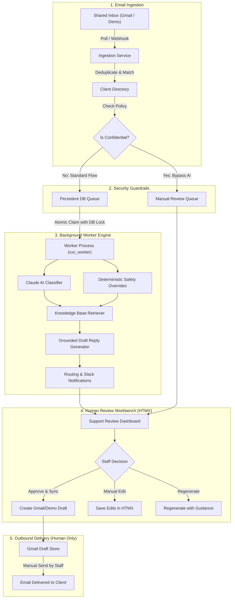
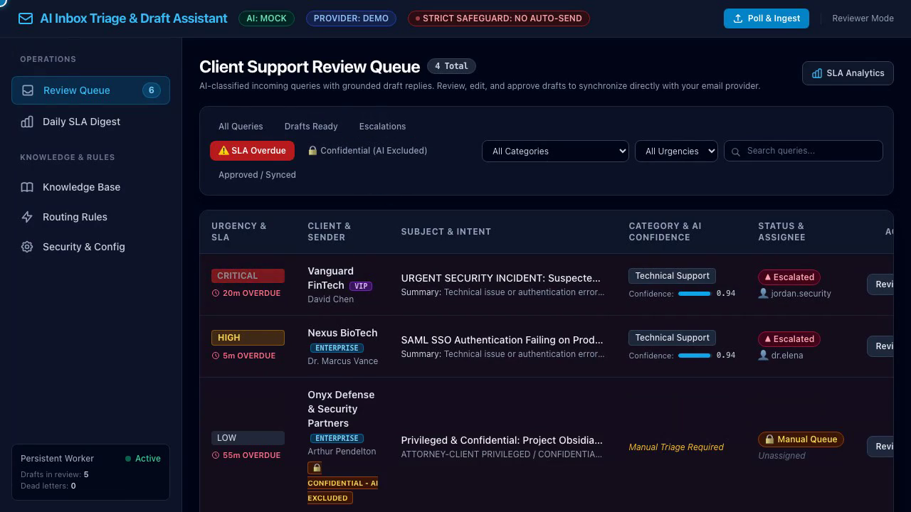
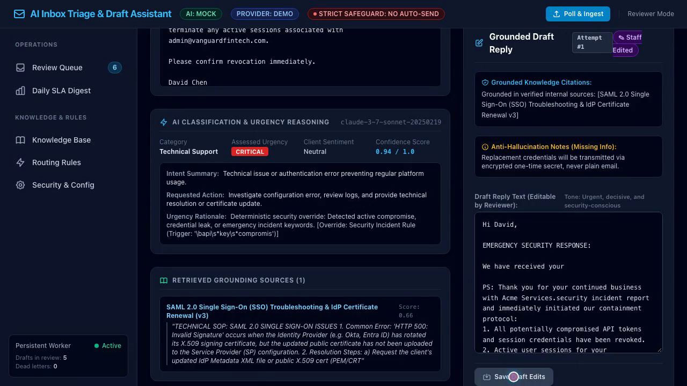
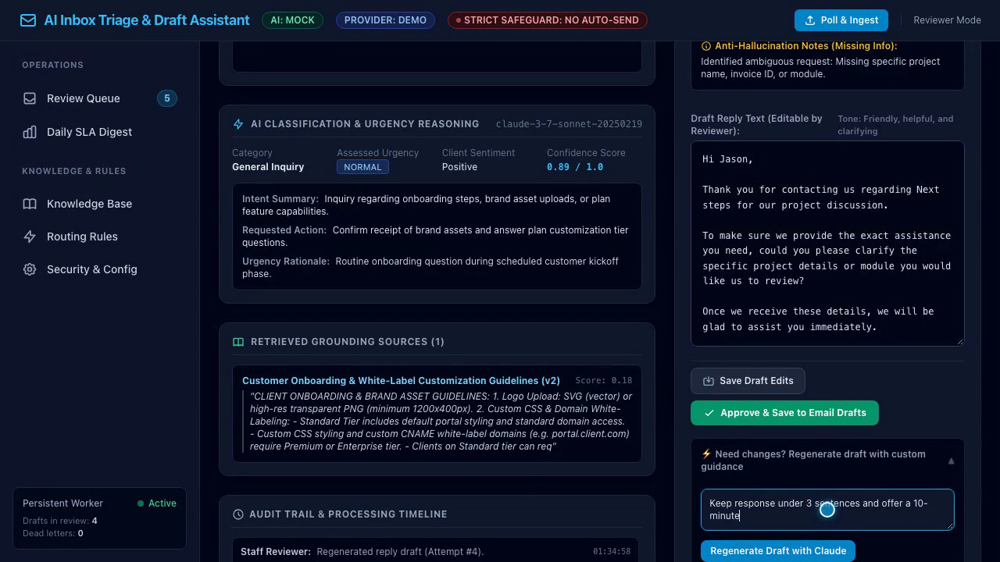
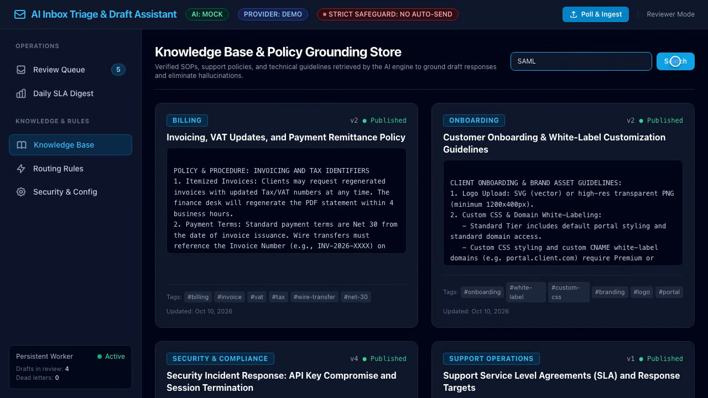

# AI Client Query Triage & Draft Reply Assistant

An intelligent, secure, human-in-the-loop email triage and grounded draft assistant built with **Python**, **Django**, **HTMX**, and **Anthropic Claude**.

Ingests incoming client queries from shared inboxes (Google Workspace / Gmail or simulated inboxes), classifies urgency and intent, retrieves verified internal policies, drafts grounded responses with inline citations, and creates pending drafts in your email client—with a strict guarantee that **no email is ever sent automatically**.

---

## 🌟 Key Capabilities

1. **Shared Inbox Ingestion & Deduplication**: Integrates with Google Workspace (Gmail API) or offline demo mode. Automatically resolves client accounts and deduplicates incoming emails.
2. **Claude 3.7 Sonnet AI Classification**: Structured extraction of Category, Urgency, Client Sentiment, Intent Summary, and Requested Actions.
3. **Deterministic Urgency & Security Overrides**: Regex safety rules detect account compromises, API token leaks, and production outages, elevating urgency to `critical` regardless of LLM confidence.
4. **Grounded Retrieval (RAG) & Citations**: Searches verified internal knowledge base articles and attaches traceable citations to drafted responses.
5. **Confidential Client Isolation (AI-Bypass)**: Clients marked as confidential strictly bypass all external AI processing; email contents are never sent to Anthropic.
6. **Persistent Database Job Queue**: Custom DB-backed queue with atomic row locking, exponential backoff, jitter, and abandoned job crash recovery. (No Redis/Celery required).
7. **Side-by-Side Review Workbench (HTMX)**: Support staff can inspect classifications, edit drafts, regenerate responses with custom guidance, and approve drafts with zero page reloads.
8. **Least-Privilege Gmail Draft Creation**: Generates email drafts directly inside original Gmail threads (`users.drafts.create`). Scopes strictly forbid automated sending.
9. **Daily SLA & Operations Digest**: Calculates overdue queries dynamically based on client SLA targets and generates automated summaries.

---

## 🏗️ Architecture & Data Flow



---

## 🚀 Quickstart Guide

### 1. Prerequisites
- Python 3.10+ (Tested on Python 3.13)
- Git

### 2. Clone and Setup Environment
```bash
# Clone the repository
git clone https://github.com/your-username/client-query-triage.git
cd client-query-triage

# Create virtual environment
python3 -m venv venv
source venv/bin/activate

# Install dependencies
pip install -r requirements.txt # or: pip install django anthropic google-api-python-client google-auth-oauthlib pydantic rich
```

### 3. Run Database Migrations
```bash
python manage.py migrate
```

### 4. Seed Demo Data
Populate realistic fictional clients, knowledge articles, routing rules, and sample client emails:
```bash
python manage.py seed_demo
```

### 5. Start the Application & Worker

In **Terminal Session 1** (Web Server):
```bash
python manage.py runserver
```
Visit the dashboard at **`http://127.0.0.1:8000/`**.

In **Terminal Session 2** (Persistent Background Worker):
```bash
python manage.py run_worker
```

---

## ⚙️ Configuration (`.env`)

Copy `.env.example` to `.env` to configure modes and secrets:

```bash
cp .env.example .env
```

| Environment Variable | Options / Default | Description |
| :--- | :--- | :--- |
| `AI_MODE` | `mock` (default) \| `claude` | Use local mock or live Anthropic Claude API |
| `ANTHROPIC_API_KEY` | `sk-ant-...` | Anthropic API key (required if `AI_MODE=claude`) |
| `ANTHROPIC_MODEL` | `claude-3-7-sonnet-20250219` | Model identifier |
| `EMAIL_MODE` | `demo` (default) \| `gmail` | Use local simulator or Google Workspace Gmail API |
| `GMAIL_CREDENTIALS_FILE` | `credentials.json` | Google Cloud OAuth Client ID credentials file |
| `GMAIL_TOKEN_FILE` | `token.json` | Stored OAuth authorized user token |
| `NOTIFICATION_MODE` | `log` (default) \| `slack` \| `teams` | Alert dispatcher adapter |
| `WORKER_POLL_INTERVAL`| `2.0` | Background worker sleep interval in seconds |

---

## 🧪 Running Automated Tests

The repository includes a comprehensive 22-test suite testing queue mechanics, backoff, crash recovery, AI schemas, deterministic overrides, confidentiality isolation, and Gmail draft mocking:

```bash
python manage.py test tests
```

To run the objective accuracy benchmark evaluation:
```bash
python manage.py evaluate_triage
```

To generate the daily SLA digest in your terminal:
```bash
python manage.py daily_summary
```

---

## 🔒 Security & Privacy Model

1. **Absolute Anti-Auto-Send Guarantee**:
   - The application **cannot** send emails. No endpoint or background job exists with sending capability.
   - Gmail OAuth scopes are strictly limited to `gmail.readonly` (ingestion) and `gmail.compose` (draft creation only).
2. **Confidential Client Isolation**:
   - Clients flagged with `is_confidential=True` automatically bypass AI processing in backend services.
   - Email subjects, bodies, and client notes are never passed over the network to external LLMs.
3. **Traceable Citations**:
   - Draft replies explicitly cite the knowledge base article title and version.
   - If context is missing, the model asks for clarification rather than hallucinating facts.

---

## 📂 Documentation & Portfolio Assets

Detailed technical documentation is available in `docs/portfolio/`:
- [Architecture Blueprint](file:///Users/kalmin/projects/client_query_triage/docs/portfolio/architecture.md)
- [Workflow & Lifecycle](file:///Users/kalmin/projects/client_query_triage/docs/portfolio/workflow.md)
- [Security & Governance](file:///Users/kalmin/projects/client_query_triage/docs/portfolio/security.md)
- [Reproducible Demo Scenarios](file:///Users/kalmin/projects/client_query_triage/docs/portfolio/demo-scenarios.md)
- [Accuracy & Safety Evaluation](file:///Users/kalmin/projects/client_query_triage/docs/portfolio/evaluation.md)


## 🖼️ Application Screenshots

| Unified Triage & Priority Inbox | Interactive Response Workbench |
|:---:|:---:|
|  |  |
| *Real-time sentiment scoring, SLA timer, & automated routing* | *Draft response generator with policy & RAG citations* |

| Smart Draft Regeneration & Tone Shift | Operational Analytics & Trends |
|:---:|:---:|
|  |  |
| *Context-aware tone adjustment and guardrail compliance* | *Resolution times, category distributions, & sentiment heatmaps* |
