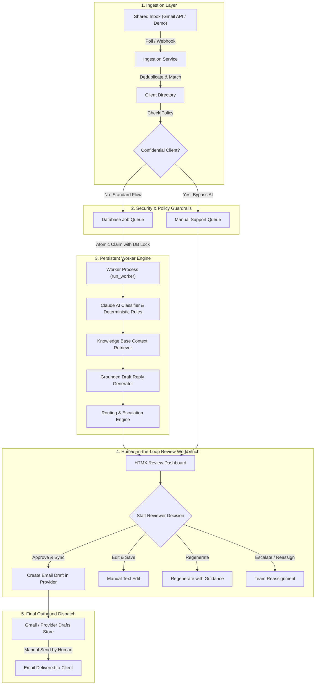

# System Architecture: AI Client Query Triage & Draft Reply Assistant

## 1. Executive Summary

The **AI Client Query Triage and Draft Reply Assistant** is a production-grade, human-in-the-loop support automation system built with Python, Django, HTMX, and Anthropic Claude.

It ingests incoming client emails from shared inboxes (Google Workspace / Gmail or simulated inboxes), performs structured AI categorization and urgency assessment, retrieves verified policy context from a local knowledge base, drafts grounded responses with inline citations, and routes urgent cases to the appropriate team members—while strictly enforcing the invariant that **no email is ever sent automatically**.

---

## 2. Architectural Blueprint

---

## 3. Core Subsystems

### A. Email Ingestion & Normalization (`ingestion/`)
- **Abstract Interface**: `EmailProviderBase` standardizes all providers (`DemoEmailProvider`, `GmailProvider`) to produce `NormalizedEmail` objects.
- **Atomic Deduplication**: Uniqueness is enforced at the database level on `(provider, provider_message_id)`. Polling the same email multiple times is completely idempotent.
- **Client Resolution**: Matches senders against registered email identities (`ClientEmailIdentity`) and company primary domains (`primary_domain`).

### B. Persistent Database-Backed Job Queue (`worker/`)
- **No External Broker Requirement**: Operates without Redis, Celery, or RabbitMQ, relying on database transactions with atomic row locking (`select_for_update`) and state transitions (`pending` -> `running` -> `completed` / `failed` -> `dead_letter`).
- **Crash Recovery**: Automatically reclaims abandoned jobs from crashed workers whose leases have expired (`WORKER_LEASE_SECONDS = 300`).
- **Exponential Backoff with Jitter**: Automatically reschedules transient failures with exponential delay (`2^attempt + jitter`).

### C. AI Classification & Deterministic Overrides (`triage/`)
- **Structured Schema**: Validates model output into Pydantic models containing `category`, `urgency`, `sentiment`, `intent_summary`, `requested_action`, `confidence_score`, `is_escalation_required`, and reasoning fields.
- **Deterministic Rules Engine**: Inspects email content for active security emergencies (e.g. leaked API keys, data breaches, ransomware) and service outages (e.g. SAML SSO Error 500), forcing `urgency='critical'` and immediate staff escalation regardless of LLM confidence.
- **Prompt Injection Defense**: Incoming email content is treated as untrusted user data. Model instructions explicitly forbid role alterations or revealing keys.

### D. Grounded Knowledge Retrieval & Anti-Hallucination (`triage/`)
- **Database Full-Text Search**: Retrieves matching `KnowledgeArticle` passages filtered by category and client restrictions without vector database dependencies.
- **Persistent Citations**: Links drafts directly to `KnowledgeSourceReference` records with supporting excerpts and relevance scores.
- **Missing Information Highlighting**: Clearly flags missing details rather than inventing numbers, commitments, or deadlines.

### E. Human Review Workbench & Least-Privilege Drafts (`dashboard/`)
- **HTMX Reactive UI**: Side-by-side workbench displaying original email, client SLA profile, AI reasoning, retrieved citations, and editable draft composer.
- **Strict Least-Privilege OAuth Scopes**: Gmail integration requests `gmail.readonly` and `gmail.compose` (draft creation only). No `gmail.send` scope is ever requested.
