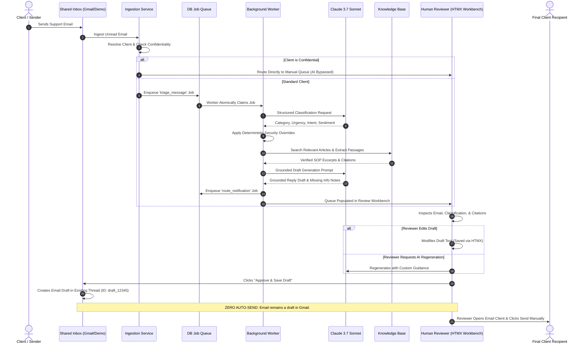

# End-to-End Workflow & Triage Lifecycle

## 1. Lifecycle Sequence Diagram

---

## 2. Detailed Phase Breakdown

### Step 1: Ingestion & Deduplication
1. Incoming emails are retrieved from the shared inbox by `IngestionService`.
2. The service checks `EmailMessage` for existing `(provider, provider_message_id)`.
3. If new, the sender's domain or email address is matched against `Client` and `ClientEmailIdentity`.

### Step 2: Policy & Confidentiality Guardrail
- If `client.is_confidential == True`, the message body is **never transmitted to any LLM**.
- The message is flagged as `excluded_confidential`, an `AuditEvent` is recorded, and the ticket is routed directly to the manual staff review queue.

### Step 3: Classification & Deterministic Safety Overrides
- The message is analyzed by Claude 3.7 Sonnet for category, urgency (low, normal, high, critical), sentiment, and requested actions.
- The `DeterministicRuleEngine` evaluates the text against safety patterns. If an active credential leak or service disruption is found, urgency is deterministically elevated to `critical`.

### Step 4: Knowledge Retrieval & Grounded Drafting
- The `KnowledgeRetriever` searches published articles and extracts supporting passages.
- Claude composes a draft reply constrained to verified knowledge, adding inline citations and explicit notes on any missing information.

### Step 5: Staff Review & Gmail Draft Synchronization
- The support agent reviews the side-by-side dashboard, edits the draft if needed, or regenerates it with custom instructions.
- Upon clicking **Approve & Save**, the application invokes `GmailProvider.create_draft_reply()` to save the draft in the Gmail thread.
- The agent conducts final authorization and manually sends the message from their email client.
